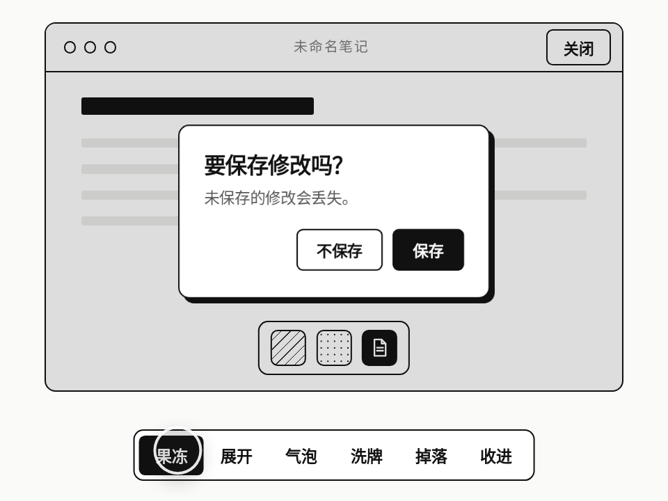

# 弹窗进出场六式 · Dialog Entrances

> **灵感来自 [yui540](https://x.com/yui540) 的 [motions/30](https://yui540.com/motions/30)**。AniMuse 版改成了黑白线稿，只保留动效本身；代码和美术都是原创，没有使用任何原作素材或代码。

同一个“要保存修改吗？”对话框，六种成对的进场 / 退场：果冻弹出、从一条线展开、从按钮长出来的气泡、三张卡洗牌、从天上掉下来、从 Dock 里吸出来再收回去。黑白线稿，只看动效本身。

- 分类：转场
- 技术：CSS / JS / WAAPI，无依赖，直接双击 `index.html` 就能看

## 怎么做的

每种方式就是一对 WAAPI 关键帧。果冻：阻尼弹簧采样，scaleY 比 scaleX 晚 3 帧，差出来的那半拍就是“抖”。气泡 / Dock：先量出按钮或图标相对对话框的位移，从那里缩放出来；Dock 再叠一个梯形 clip-path 当“漏斗”。掉落：ease-in 下落、落地压扁、再小跳一下，背景跟着震。焦点在对话框里循环，Esc / 点遮罩关闭，关完焦点回到触发按钮。

## 可调参数

| 参数 | 默认值 | 说明 |
| --- | --- | --- |
| `--in` | `620ms` | 进场基准时长（各方式按比例缩放） |
| `--out` | `320ms` | 退场基准时长 |
| `--wobble` | `2.1` | 果冻回弹频率（Hz） |
| `--bounce` | `.34` | 果冻回弹阻尼比 |

CSS 变量在 `style.css` 顶部的 `:root` 里。

## 搬到自己项目里

挑一种喜欢的直接用：每种都是一个 enter() / exit() 函数，换到自己的 <dialog> 上就行。退场一定要比进场短。

所有动画都尊重 `prefers-reduced-motion: reduce`（直接切到结果，不做位移和回弹），键盘可以完整操作。

---

**EN** — One “Save your changes?” dialog, six paired entrances and exits: jelly pop, unfold from a line, a bubble that grows out of the button, a shuffled card stack, a drop from the sky, and a genie-ish pop out of (and back into) the Dock. Black-and-white line art, so only the motion speaks.

> **Inspired by [yui540](https://x.com/yui540)’s [motions/30](https://yui540.com/motions/30)**. AniMuse’s version is black-and-white line art so only the motion speaks; code and art are original — no assets or code were used.

Each style is a pair of WAAPI keyframe sets. Jelly: a sampled damped spring with scaleY lagging scaleX by 3 frames — that half-beat is the wobble. Bubble / Dock: measure the trigger’s offset from the dialog and scale out of it; Dock adds a trapezoid clip-path as the funnel. Drop: ease-in fall, squash on landing, a small hop, the background shakes. Focus is trapped, Esc / scrim click closes, focus returns to the trigger.

| Param | Default | Notes |
| --- | --- | --- |
| `--in` | `620ms` | base entrance duration (scaled per style) |
| `--out` | `320ms` | base exit duration |
| `--wobble` | `2.1` | jelly rebound frequency (Hz) |
| `--bounce` | `.34` | jelly damping ratio |

Pick one and use it: every style is just an enter() / exit() pair you can drop onto your own <dialog>. Keep exits shorter than entrances. Fully keyboard-operable; respects `prefers-reduced-motion: reduce`.
