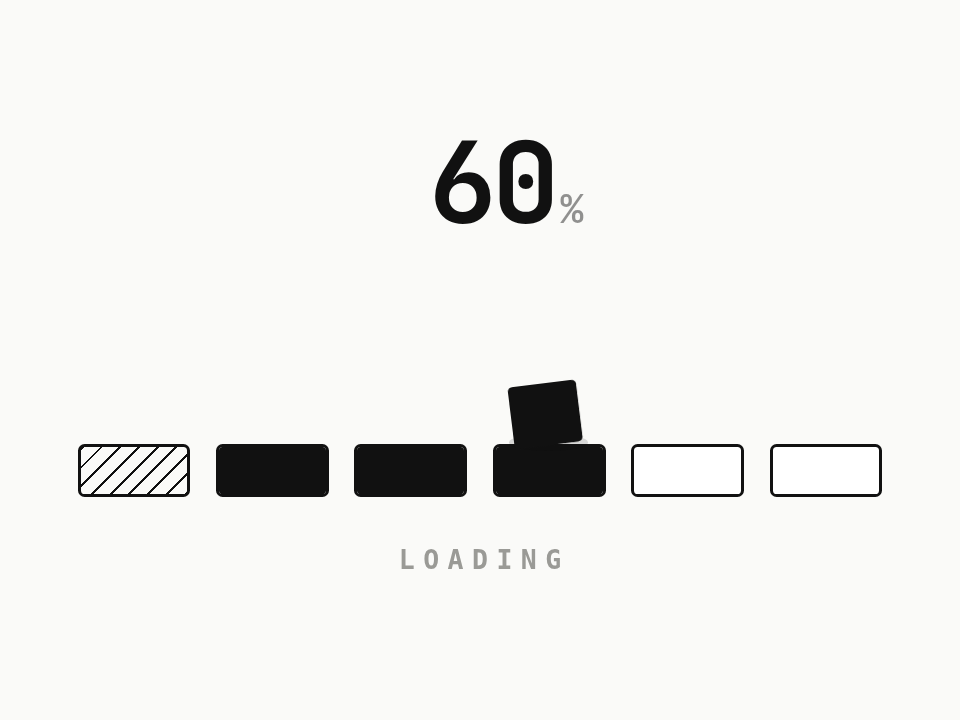

# 跳格子加载 · Hop Loader

> **灵感来自 [yui540](https://x.com/yui540)** 的设计语言。代码、角色和美术都是原创，没有使用任何原作素材。

一个黑方块沿着进度格一格格往前跳，每落一格就把那格“踩实”。进度卡住时它原地左右歪两下蓄力；到 100% 翻个跟头，撒出一把小方块。

- 分类：加载
- 技术：CSS / JS / WAAPI，无依赖，直接双击 `index.html` 就能看

## 怎么做的

一条 async 时间线串起每一跳：下蹲 → 起跳拉长 → 抛物线（x 线性、y 用两段 ease）→ 落地压扁回弹。被踩的格子下沉一下，黑色从底部灌满。百分比数字跟着落地的瞬间跳。

## 可调参数

| 参数 | 默认值 | 说明 |
| --- | --- | --- |
| `--hop` | `420ms` | 一次跳跃的空中时间 |
| `--height` | `2.6rem` | 跳多高 |
| `--squash` | `.78` | 落地压扁到多少 |
| `--hero` | `#111` | 方块颜色 |

CSS 变量在 `style.css` 顶部的 `:root` 里。

## 搬到自己项目里

接真实进度时，把“跳到第几格”绑到下载 / 上传进度上，卡住超过 1.5 秒再触发原地歪头。

所有动画都尊重 `prefers-reduced-motion: reduce`。

---

**EN** — A black block hops along the progress tiles, filling each one it lands on. When progress stalls it tilts side to side, winding up; at 100% it flips and scatters a handful of squares.

> **Inspired by [yui540](https://x.com/yui540)**’s design language. Code, characters and art are original; no assets were used.

One async timeline chains every hop: crouch → stretch on take-off → parabola (linear x, two eased halves on y) → squash and rebound on landing. The tile dips and fills with ink from the bottom; the percentage ticks on each landing.

| Param | Default | Notes |
| --- | --- | --- |
| `--hop` | `420ms` | air time per hop |
| `--height` | `2.6rem` | hop height |
| `--squash` | `.78` | landing squash |
| `--hero` | `#111` | block color |

Bind the target tile to real progress; trigger the tilt only after ~1.5s without change.
