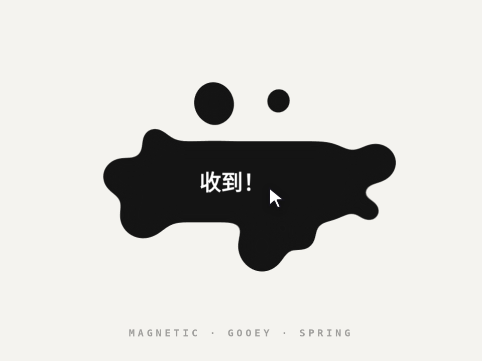

# 液态磁吸按钮 · Liquid Magnetic Button

指针靠近，按钮整体被吸过去一点，同时一截液体从边缘伸出来去够指针，离开时拉出细颈再“啵”地断开缩回。点一下炸成一圈水珠，再一颗颗融回去。

- 分类：按钮
- 技术：SVG filter / CSS / JS，无依赖，直接双击 `index.html` 就能看

## 怎么做的

SVG goo 滤镜：feGaussianBlur 模糊 + feColorMatrix 把 alpha 拉陡（×24 −10），靠近的形状就会粘连。四个弹簧体：本体、伸出的液体、更远的一滴、文字；液体目标点 = 本体中心 + 方向 × min(距离, 椭圆边缘距离 + reach)。文字不进滤镜，所以始终清晰。

## 可调参数

| 参数 | 默认值 | 说明 |
| --- | --- | --- |
| `--field` | `11rem` | 磁场半径 |
| `--pull` | `.3` | 本体跟过去的比例 |
| `--reach` | `1.8rem` | 液体最多伸出多远 |
| `--goo` | `.55` | 粘稠度（模糊半径 = goo × 1rem） |
| `--liquid` | `#141414` | 液体颜色 |

CSS 变量在 `style.css` 顶部的 `:root` 里，`data-*` 在 `index.html` 上。

## 搬到自己项目里

按钮文字改 #txt；滤镜半径跟着 rem 算，放大缩小都不会糊。注意 goo 层要比按钮大一圈，不然水珠飞出去会被裁掉。

所有动画都尊重 `prefers-reduced-motion: reduce`：系统开了「减少动态效果」时直接显示最终状态。

---

**EN** — As the pointer nears, the button drifts toward it while a blob of liquid reaches out from the edge; leave and it stretches a thin neck, snaps and retracts. Click and it bursts into droplets that merge back one by one.

SVG goo filter: feGaussianBlur + feColorMatrix steepening alpha (×24 −10) so nearby shapes fuse. Four springs: body, reaching blob, a farther droplet and the label; the blob target is centre + dir × min(distance, ellipse edge + reach). The label stays outside the filter so it is always crisp.

| Param | Default | Notes |
| --- | --- | --- |
| `--field` | `11rem` | magnetic field radius |
| `--pull` | `.3` | how far the body follows |
| `--reach` | `1.8rem` | max reach beyond the edge |
| `--goo` | `.55` | gooeyness (blur = goo × 1rem) |
| `--liquid` | `#141414` | liquid color |

Edit #txt for the label; the blur scales with rem so it holds at any size. Keep the goo layer larger than the button or flying droplets get clipped.
