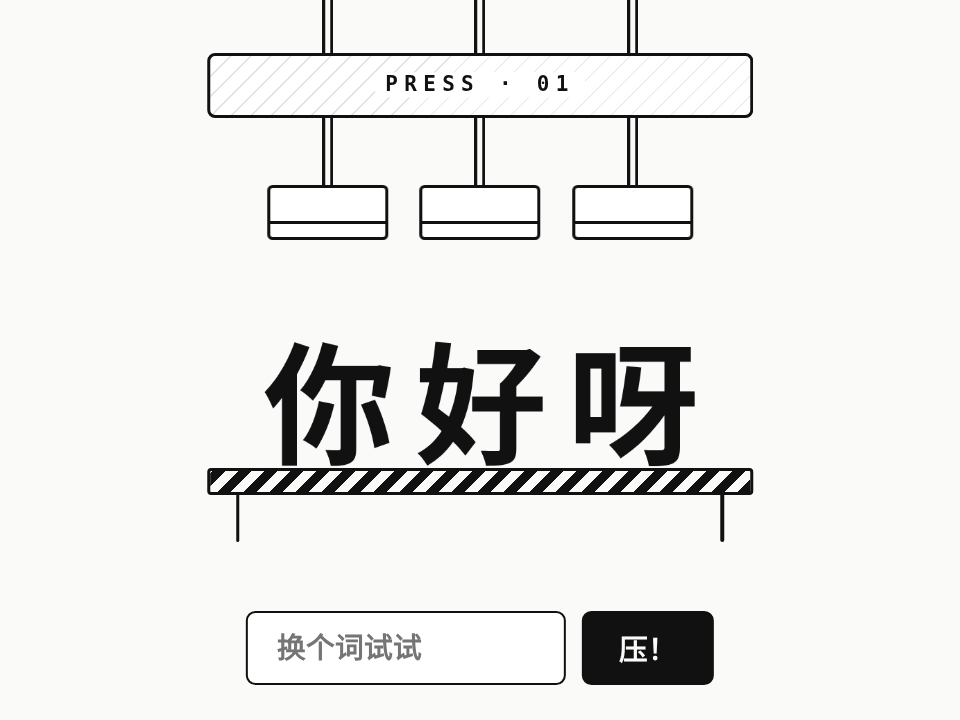

# 压字机 · Press Type

> **灵感来自 [yui540](https://x.com/yui540) 的 [motions/51](https://yui540.com/motions/51)**。AniMuse 版改成了黑白线稿，只保留动效本身；代码和美术都是原创，没有使用任何原作素材或代码。

标题入场：一排黑白线稿的压机依次砸下来，每砸一下就从料块里“压”出一个字——先被压扁，再按阻尼弹簧回到原形，旁边冒两团小烟。下面可以输入自己的词再压一遍，点任意一个字也能单独再压一次。

- 分类：文字
- 技术：CSS / JS / WAAPI，无依赖，直接双击 `index.html` 就能看

## 怎么做的

压头用 ease-in 加速砸下（150ms），停 60ms 再带一点过冲弹回去。字从 scaleY(0.48) 开始按阻尼弹簧回到 1：x(t)=1+(x₀−1)·e^(−ζωt)(cos ω_d t + ζω/ω_d·sin ω_d t)，采样成 30 个关键帧，scaleX = 1/√scaleY 保持体积。错峰每台 140ms，奇偶交替快慢一点点，听起来更像机器。

## 可调参数

| 参数 | 默认值 | 说明 |
| --- | --- | --- |
| `--stagger` | `140ms` | 每台压机之间错开多久 |
| `--slam` | `150ms` | 压头砸下来的时长 |
| `--squash` | `.48` | 字被压到多扁（scaleY） |
| `--wobble` | `2.3` | 回弹频率（Hz） |
| `--bounce` | `.3` | 回弹阻尼比，越小弹得越久 |

CSS 变量在 `style.css` 顶部的 `:root` 里。

## 搬到自己项目里

适合活动页标题、欢迎语、空状态大字。中文、英文都能排；每个字是一个按钮，读屏会读整句。

所有动画都尊重 `prefers-reduced-motion: reduce`（直接切到结果，不做位移和回弹），键盘可以完整操作。

---

**EN** — A headline entrance: a row of line-drawn presses slam down one after another, each stamping a letter out of a block — squashed flat first, then springing back along a damped spring with a puff. Type your own word to press it again, or click any letter to re-press it.

> **Inspired by [yui540](https://x.com/yui540)’s [motions/51](https://yui540.com/motions/51)**. AniMuse’s version is black-and-white line art so only the motion speaks; code and art are original — no assets or code were used.

Heads slam down with ease-in (150ms), dwell 60ms and spring back up with a little overshoot. Each letter starts at scaleY(0.48) and returns to 1 along a damped spring: x(t)=1+(x₀−1)·e^(−ζωt)(cos ω_d t + ζω/ω_d·sin ω_d t), sampled into 30 keyframes, with scaleX = 1/√scaleY to keep volume. 140ms stagger, alternating slightly faster/slower so it feels mechanical.

| Param | Default | Notes |
| --- | --- | --- |
| `--stagger` | `140ms` | delay between presses |
| `--slam` | `150ms` | slam duration |
| `--squash` | `.48` | squash amount (scaleY) |
| `--wobble` | `2.3` | rebound frequency (Hz) |
| `--bounce` | `.3` | rebound damping ratio |

For event headlines, welcome screens or big empty-state text. Works with Latin and CJK; each letter is a button and screen readers get the whole word. Fully keyboard-operable; respects `prefers-reduced-motion: reduce`.
