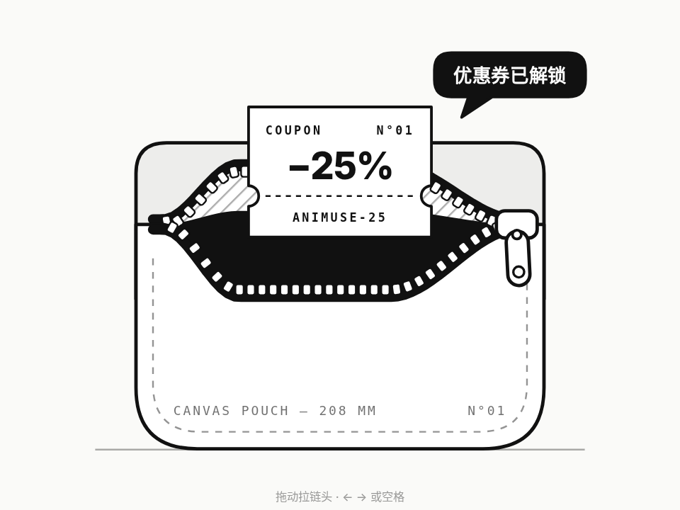

# 拉链揭开 · Zip Reveal

> **灵感来自 [yui540](https://x.com/yui540) 的 [motions/60](https://yui540.com/motions/60)**。AniMuse 版改成了黑白线稿，只保留动效本身；代码和美术都是原创，没有使用任何原作素材或代码。

一个黑白线稿的帆布收纳袋。拖动拉链头，齿链沿曲线一颗颗分开、缝越张越大，拉片跟着手甩；拉到一半能从缝里看到一张优惠券的边，拉到底它整张升起来。没拉到底就松手，拉链会弹回去。

- 分类：物理
- 技术：SVG / JS，无依赖，直接双击 `index.html` 就能看

## 怎么做的

缝的宽度 = 最大宽度 × smoothstep(离拉链头的距离) × smoothstep(离起点的距离)，上唇往上抬、下唇往下压，每帧重算两条曲线；齿沿曲线排、按切线旋转，合上的部分上下交错咬合。拉链头是弹簧（跟手时硬、弹回去时软），拉片是挂在拉链头上的单摆。优惠券被裁在“下唇上方”的区域里，所以只会从缝里出来。

## 可调参数

| 参数 | 默认值 | 说明 |
| --- | --- | --- |
| `--gap` | `72` | 拉开后缝最宽多少（SVG 单位） |
| `--snap` | `.78` | 拉过这个比例松手就自动拉到底 |
| `--stiff` | `190` | 拉链头跟手的弹簧刚度 |
| `--back` | `90` | 弹回去的弹簧刚度（越小越慢） |

CSS 变量在 `style.css` 顶部的 `:root` 里。

## 搬到自己项目里

适合优惠码、彩蛋、隐藏答案、礼品卡这种“拉开看看”的场景。拉链头是 role="slider"，键盘 ← → / Home / End / 空格都能操作。

所有动画都尊重 `prefers-reduced-motion: reduce`（直接切到结果，不做位移和回弹），键盘可以完整操作。

---

**EN** — A black-and-white line-art canvas pouch. Drag the zipper pull and the teeth part one by one along a curve while the pull tab swings; halfway you glimpse the edge of a coupon, all the way and it rises out. Let go too early and the zipper springs back shut.

> **Inspired by [yui540](https://x.com/yui540)’s [motions/60](https://yui540.com/motions/60)**. AniMuse’s version is black-and-white line art so only the motion speaks; code and art are original — no assets or code were used.

Gap width = max × smoothstep(distance to the slider) × smoothstep(distance to the start stop); the upper lip lifts and the lower lip drops, both curves rebuilt every frame. Teeth sit along the curves rotated to the tangent and interlock where closed. The slider is a spring (stiff while dragging, softer when snapping back) and the pull tab is a pendulum hanging from it. The coupon is clipped to the area above the lower lip, so it can only come out of the gap.

| Param | Default | Notes |
| --- | --- | --- |
| `--gap` | `72` | max gap width (SVG units) |
| `--snap` | `.78` | past this fraction it auto-completes on release |
| `--stiff` | `190` | slider stiffness while dragging |
| `--back` | `90` | stiffness when springing back |

Good for coupon codes, easter eggs, hidden answers or gift cards. The pull is a role="slider": ← → / Home / End / Space all work. Fully keyboard-operable; respects `prefers-reduced-motion: reduce`.
